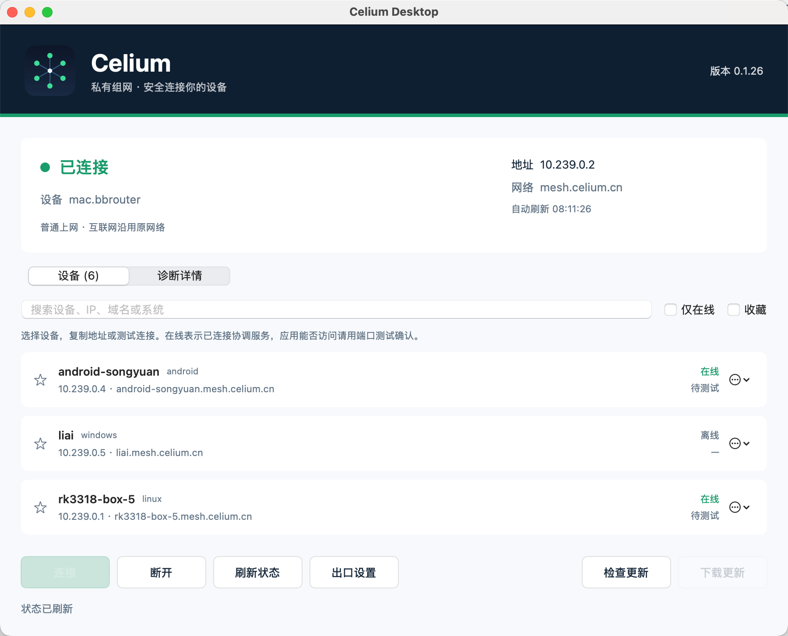

  
  <h1>Celium</h1>
  
<strong>随时连接你的设备与服务</strong>

  
把电脑、手机与服务器连接到同一个设备网络，让远程访问更简单、设备管理更清晰。

  

    <a href="https://celium.cn">官方网站</a> ·
    <a href="https://www.celium.cn/docs/install/">下载客户端</a> ·
    <a href="https://www.celium.cn/docs/quickstart/">快速开始</a> ·
    <a href="https://login.celium.cn/admin">网络管理</a>
  

## 连接设备，直接开始工作

在外使用办公室电脑、从手机访问家中的服务，或管理分布在不同地点的服务器，通常需要反复处理地址、端口和网络环境。Celium 将设备连接与日常管理放到一个界面中：找到设备、复制地址、测试连接，再使用你熟悉的 SSH、远程桌面或浏览器。

**适合个人设备、家庭服务与小团队协作。** 远程服务由你的设备提供，访问范围由网络管理员控制。

产品界面示例：用户提供的 macOS Celium Desktop 截图。各平台的界面与功能支持可能有所差异。

## 你可以用它做什么

| 使用场景 | Celium 如何帮助你 |
| --- | --- |
| 远程办公 | 连接自己的办公电脑，用现有远程桌面工具访问工作环境 |
| 开发与运维 | 通过设备地址或 MagicDNS 名称访问服务器，测试 SSH、HTTPS 等服务端口 |
| 家庭设备访问 | 连接电脑、手机与家庭服务器，访问自己部署的文件或应用服务 |
| 团队设备管理 | 在管理页面授权设备、管理成员与访问策略，明确哪些设备可以互相访问 |
| 连接问题排查 | 查看连接状态，分别判断设备隧道与应用端口，减少“在线但访问不了”的困惑 |

## 核心体验

- **安全的设备连接**：加密设备间通信，优先尝试直连；无法直连时使用经过设备认证的中继路径。
- **MagicDNS**：使用设备名称访问同一网络中的设备，减少记忆和查找 IP 地址的负担。
- **清晰的连接状态**：自动刷新设备状态，区分在线、离线、正在连接与需要处理的健康信息。
- **更快找到常用设备**：按设备名、IP、域名或系统搜索，配合仅在线筛选和收藏。
- **实用的诊断工具**：复制设备地址、测试隧道连接、检查常用 TCP 服务端口，并导出经过字段筛选的诊断信息。
- **普通上网保持原连接**：默认仅连接设备网络；需要时可选择你有权使用且已由管理员批准的出口设备，也可切回普通上网。
- **管理与权限控制**：通过浏览器完成设备授权，由管理员管理设备、成员及访问策略。

> 设备“在线”表示其协调连接状态；目标服务仍需已启动，并允许相应端口的访问。可使用客户端诊断进一步确认。

## 下载与开始使用

**[进入官方下载与安装页面 →](https://www.celium.cn/docs/install/)**

| 平台 | 获取方式 |
| --- | --- |
| Windows | 官网安装包；Microsoft Store 版正在认证，发布后可通过下方商店入口获取 |
| macOS | 官网 DMG，分别提供 Apple Silicon 与 Intel 安装包 |
| Linux | 官网 APT 安装说明与命令行工具 |
| Android | 官网 APK 与安装说明 |

**[Microsoft Store 产品入口](https://apps.microsoft.com/detail/9NG58H0X0Q2W)** — 截至 2026-10-05，商店版处于认证阶段，通过认证后发布。当前可先使用官网下载方式。

1. 为你的设备安装对应平台的 Celium 客户端。
2. 登录账号，在浏览器中确认并授权要加入的设备。
3. 让另一台设备加入同一网络，在客户端中查看并复制它的地址。
4. 使用 SSH、远程桌面或浏览器访问该设备已经运行的服务。

Windows 官网安装版请从开始菜单打开 **Celium Desktop**；`celium.exe` 是命令行工具。商店版通过 Microsoft Store 安装和更新。

## 本仓库公开什么

这里是 **Microsoft Store 客户端界面与 Windows 平台封装的部分公开源码**，用于展示产品交互与平台集成方式。

| 目录 | 内容 |
| --- | --- |
| [`client/windows`](client/windows) | 桌面界面、状态刷新、设备搜索、诊断入口和启动脚本 |
| [`client/windows/store`](client/windows/store) | 商店启动参数处理、Windows 原生应用激活与连接配置管理封装 |
| [`packaging/msix`](packaging/msix) | 使用占位身份信息的 MSIX 清单示例与说明 |
| [`docs`](docs) | 公开范围、客户端架构说明及产品展示图片 |

**本仓库不包含网络核心源码、协调服务器、中继服务器、数据库、生产部署配置、账号数据、密钥或签名材料。** 因此，它不能独立编译成完整的 Celium 客户端。需要使用产品，请下载官方发行版。

源码公开范围见 [SOURCE_SCOPE](docs/SOURCE_SCOPE.md)，界面与内部组件的边界见 [客户端架构说明](docs/CLIENT_ARCHITECTURE.md)。本仓库是部分源码公开展示，未附加通用开源许可证。

## 支持与反馈

- 使用与安装：[帮助文档](https://www.celium.cn/docs/)
- 产品问题与建议：[提交 Issue](https://github.com/uulucky/celium/issues)
- 联系支持：[support@celium.cn](mailto:support@celium.cn)
- 隐私政策：[查看隐私政策](https://www.celium.cn/privacy/)

提交反馈时，建议提供系统版本、客户端版本、操作步骤及预期结果。公开 Issue 中请勿上传密码、令牌、密钥或未经脱敏的完整诊断记录。

---

本软件为网络连接与设备管理客户端，不提供网络节点、互联网接入、境外网络访问或通信线路服务。用户需自行配置并使用其合法拥有或有权使用的网络资源。
