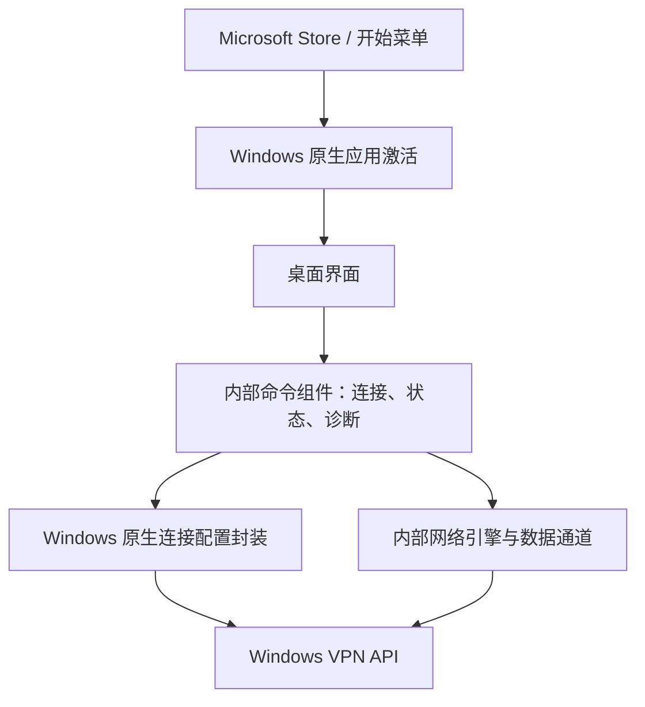

# 客户端架构与交互边界

## 商店客户端的职责

界面负责帮助用户完成连接与设备管理。底层网络状态、权限判断和数据通道由正式发行版的内部组件提供。

本仓库公开图中的桌面界面、应用激活和连接配置封装；内部命令组件、网络引擎及数据通道不公开。

## 界面如何读取状态

`CeliumClient.ps1` 使用 `status --view` 获取经过字段筛选的状态快照，在界面中显示连接标签、设备名、地址、网络、设备列表和健康信息。

- 每 5 秒请求状态刷新。
- 使用异步子进程和定时轮询，避免等待网络命令时阻塞窗口。
- 连接与断开后再次读取实际状态，确认操作是否完成。
- 支持按设备名、地址、MagicDNS 域名或系统搜索。
- 收藏保存在本机用户的数据目录。
- 诊断入口分别测试设备隧道和 TCP 端口。

界面只消费状态和诊断输出；内部状态转换及诊断实现没有包含在本仓库中。

## 平台集成

`PluginHost.cpp` 使用 Windows 原生应用激活及 `FullTrustProcessLauncher` 启动桌面界面。`activation.go` 处理平台附加的启动参数。

`Host.cpp` 使用 `VpnManagementAgent` 管理属于当前包身份的连接配置，不改写属于其他应用的同名配置。正式商店版使用 Windows 原生 VPN API；数据通道及其网络引擎未公开。

商店版的更新入口交由 Microsoft Store 管理。共用界面代码中的官网版更新分支依赖另外的安装版组件。

## 默认网络行为

默认访问设备网络，普通互联网连接沿用原网络。使用经过管理员批准的出口设备时，网络路由会随选择改变；切回普通上网后恢复默认行为。

退出界面与断开设备网络是不同操作。界面窗口、内部后台组件和 Windows 连接配置各有独立生命周期。
